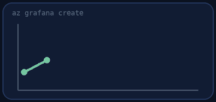
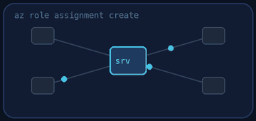
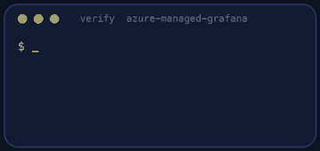
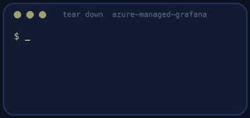

<p align="center"></p>

| | |
|-|-|
| **Time** | 105-120 min |
| **Cost** | a few tens of cents if torn down the same day (the workspace is billed per hour) |
| **You need** | An Azure subscription where you can create resources, the Azure CLI with the amg extension, Python 3 and a terminal |

## How this lab works

1. **Fork** this repository to your own GitHub account (button at the top right).
2. Clone **your fork** in your Ubuntu environment (WSL on Windows, your OrbStack machine on Mac).
3. Read the lab below (the same text is in [`LAB.md`](LAB.md)) and follow the mission.
4. Answer the questions in [`SUBMISSION.md`](SUBMISSION.md). Where a question asks for output, paste it in a code block. No screenshots needed.
5. Commit and push. Open the **Actions** tab of your fork (click *I understand my workflows, go ahead and enable them* the first time). The **Lab check** shows what is still missing.
6. When the check is green, **submit the URL of your fork** in the course platform.

> [!NOTE]
> The check only looks at your answers and any files the lab asks you to commit. Your instructor reads your work and may ask you to explain any line.

<p align="center"></p>

## 🎬 The situation

<p align="center"></p>

On Kubernetes you ran your own Grafana next to Prometheus, and you patched it, backed it up and kept it alive. The owner of the cafe asks a simple question: "Can I see the storage numbers on a screen, without you running yet another server?" Azure sells exactly that: **Azure Managed Grafana**, a Grafana that Microsoft runs, with Azure Monitor already wired in as a data source.

The catch is not Grafana. It is **identity**. A new Managed Grafana shows nothing and lets nobody in until two separate permissions exist: **you** need a Grafana role to open it (being subscription Owner is not enough), and **the workspace itself** needs a role on your Azure resources to read their metrics. Most "my dashboard is empty" tickets are one of these two.

> [!IMPORTANT]
> **Your mission**
> - Create a Managed Grafana workspace with a system-assigned managed identity
> - Give **yourself** the Grafana Admin role and the **workspace identity** the least role that can read metrics
> - Build a dashboard `Beanie storage` with at least two panels on your storage account, using the Azure Monitor data source
> - Prove that Grafana really reads the metric through its own identity
> - Tear down and prove it

**Time:** 105-120 min | **Cost:** a few tens of cents if you tear down the same day (the workspace is billed per hour while it exists) | **You need:** an Azure subscription, the Azure CLI with the `amg` extension (`az extension add -n amg`), Python 3 and a terminal.

> [!NOTE]
> **If Azure answers `QuotaExceeded` or `SkuNotAvailable`, do not worry.** It is normal when Azure is in high demand, and it happens to everyone. Run `az vm list-usage --location <region> -o table` for compute limits. To ask for more, open the portal: **Quotas > Compute > Request adjustment**, or open a support request. Managed Grafana is limited per region and subscription too: if creation fails, try another region (keep it in a variable, for example `LOC=westeurope`) or ask for an increase. Asking is the normal path, not a failure.

<p align="center"></p>

## Part 0 - The data to show

Fork this repository, clone your fork and run:

```bash
az login
./setup.sh
```

It creates the resource group `rg-grafana` and a storage account whose name starts with `stgraf`, with a container `receipts`. Upload a file or two, and read them a few times, so that the account has some traffic to draw.

<p align="center"></p>

## Part 1 - The workspace

<p align="center"></p>

Create the workspace in `rg-grafana`. Its name must start with `grafana-beanie` and be unique in the region (a suffix of the first 6 characters of your subscription id works):

```bash
az extension add -n amg
az grafana create --help
```

Use the **Standard** tier, public access enabled, and tag it `lab=azure-managed-grafana` (the teardown proof looks for the tag). Creation takes about three minutes. Open the **endpoint** URL it prints.

> [!NOTE]
> **Predict** You are Owner of the subscription and you just created the workspace. Will Grafana let you in? Try it, and read the page you get.

<p align="center"></p>

## Part 2 - Two identities, two roles

| Who | Needs | Role | Scope |
|-----|-------|------|-------|
| **You** | to open and edit dashboards | **Grafana Admin** | the workspace |
| **The workspace** (its managed identity) | to read metrics of your resources | **Monitoring Reader** | the resource group (or the subscription) |

```bash
az role assignment create --help
az grafana show -g rg-grafana -n <workspace> --query identity
```

Your own object id is in `az ad signed-in-user show --query id`, or in the `oid` claim of your token. Role assignments for a new workspace can take **a few minutes** to take effect; if you still see "No Grafana Role Assigned", wait and refresh.

> [!NOTE]
> **Think** Why Monitoring Reader and not Contributor? The workspace can now read metrics of every resource in the group. What else could a Grafana with Contributor do if someone edited a panel?

<p align="center"></p>

## Part 3 - The dashboard

In Grafana, **Dashboards > New**. The data source **Azure Monitor** is already there (you did not install it: that is what "managed" means). Build a dashboard named **`Beanie storage`** with at least two panels:

1. a time series of the metric **Transactions** (aggregation **Total**) of your storage account;
2. a second panel of your choice on the same account (Egress, Ingress, Used capacity, Availability).

Use the **Azure Monitor** query editor: pick the subscription, resource group, resource type *Storage account*, your account, the metric namespace and the metric. Generate some traffic and watch the panel move.

```bash
az grafana dashboard --help
```

> [!NOTE]
> **Think** Azure Monitor metrics are available for 93 days and only the platform metrics. If the owner wants a year of history, or the application's own numbers, what would you add? What does this Grafana replace, and what does it not replace, compared with the Prometheus and Loki you ran on Kubernetes?

<p align="center"></p>

## Part 4 - Prove it

<p align="center"></p>

```bash
./verify.sh
```

It reads your workspace, its identity and the two role assignments, signs in to Grafana as you, finds your dashboard, and sends the panel's own query through Grafana to see whether the workspace identity may read the metric. Fix what is red and run it again until it ends with **ALL CHECKS PASSED**. Paste the output into `SUBMISSION.md` **before** you tear down.

> [!TIP]
> **Stuck?** "No Grafana Role Assigned": the Grafana Admin role is missing or still propagating (a few minutes). The panel says *authorization failed*: the workspace identity has no Monitoring Reader on the group that holds the storage account. "No data": the time range, or the account had no traffic in the last hour. No access to a storage metric you can see in the portal: you used the wrong resource; check the resource name in the query.

<p align="center"></p>

## Level up (optional)

- Import a community dashboard for Azure Storage (Grafana catalog) and see which panels work with your permissions.
- Add a **Log Analytics** data source and query the activity log. Which extra role does the workspace identity need?
- Set a **dashboard variable** that lets the viewer choose the storage account. Why is that better than three copies of the dashboard?
- Create a **service account** and call the Grafana API with its token, the way a pipeline would.

<!-- teardown:start (generated by labs.py, do not edit) -->
## Tear down (mandatory)

<p align="center"></p>

Resources left behind cost money, keep doors open and pollute the next lab. Removing what you created is part of the job, so it is part of the submission: **you must prove it is gone**.

Do this **last**, after you have pasted your `verify` output into `SUBMISSION.md` (once you tear down, the lab can no longer be verified).

1. Run `./teardown.sh`. It deletes the resource group `rg-grafana` with the Grafana workspace, the storage account and the role assignments scoped to it.

Then run the proof:

```bash
./verify-teardown.sh
```

It prints a list of checks and must end with **TEARDOWN VERIFIED**. If it reports leftovers, remove them and run it again. Paste the full output in your submission.
<!-- teardown:end -->

<!-- submission:start (generated by labs.py, do not edit) -->
## 📬 Submission

Answer the questions in `SUBMISSION.md` in **your fork** (paste output in code blocks where asked), push, then submit the **URL of your fork**.

**Files to commit**

- `notes.md` with your commands (optional)

**Questions to answer**

1. Paste the commands that create the workspace and the two role assignments. Why is being subscription Owner not enough to open the Grafana you just created? What is the difference between an Azure RBAC role on the subscription and a Grafana role on the workspace?
2. Which identity reads the metrics when you open a panel: you, or the workspace? Explain with the two role assignments, and say what you would see if one of them were missing.
3. Why Monitoring Reader and not Contributor? Name one thing a compromised or careless Grafana with Contributor could do.
4. Paste the JSON of one panel query (Dashboard > panel > Inspect > Query) and explain each field: subscription, resource, metric namespace, metric, aggregation, time grain.
5. Managed Grafana versus the Grafana you ran on Kubernetes: list two things you no longer have to do, and two things you gave up or still have to do (data retention, application metrics, custom plugins, cost, access control).
6. Paste the output of `./verify.sh`. It must end with **ALL CHECKS PASSED**.
7. **Tear down.** Paste the output of `./verify-teardown.sh`. It must end with **TEARDOWN VERIFIED**.
<!-- submission:end -->
